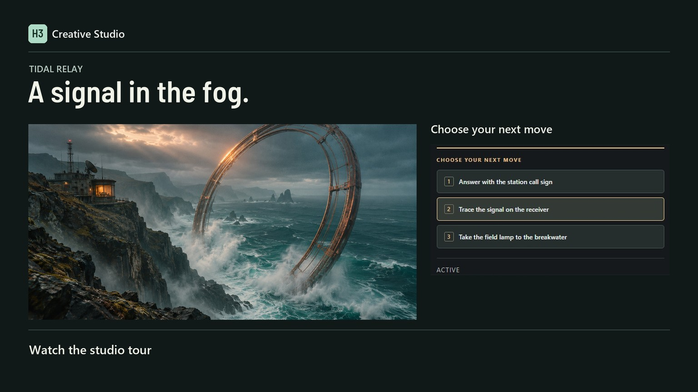
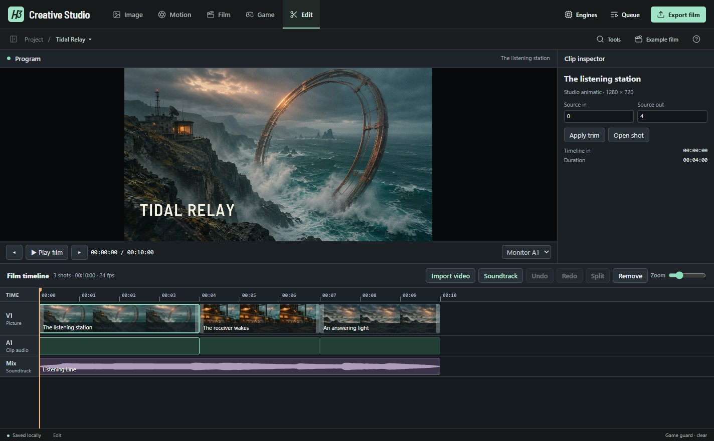

# H3 Creative Studio

Make a film in one Windows desktop app. Paint a layer, use that exact revision as a motion guide, direct a Film storyboard or an interactive Game, and cut the resulting takes together with an audio mix.

**[Download H3 Creative Studio 2.1 for Windows x64](https://github.com/BesianSherifaj-AI/h3-creative-studio/releases/download/v2.1.0/H3-Creative-Studio-2.1.0-Windows-x64.zip)** · [Release notes](https://github.com/BesianSherifaj-AI/h3-creative-studio/releases/tag/v2.1.0)

[](https://github.com/BesianSherifaj-AI/h3-creative-studio/releases/download/v2.1.0/H3-Studio-Tour-landscape.mp4)

[Watch in portrait](https://github.com/BesianSherifaj-AI/h3-creative-studio/releases/download/v2.1.0/H3-Studio-Tour-vertical.mp4) · [English captions](https://github.com/BesianSherifaj-AI/h3-creative-studio/releases/download/v2.1.0/H3-Studio-Tour.en.srt)

The tour follows the authored *Tidal Relay* episode through the Windows app. It uses the original “Listening Line” score and synthetic narration made with the af_heart voice in [Kokoro-82M](https://huggingface.co/hexgrad/Kokoro-82M).

## Open the Windows app

1. Extract the entire ZIP to a folder you can keep. Open **H3 Creative Studio.exe**. The ZIP includes Python and the desktop libraries. The community launcher is unsigned. The app uses Microsoft Edge WebView2 on Windows 10 or 11 x64.
2. The first launch opens **Tidal Relay**, a ten-second editable example. Its three scenes include layered plates, frame guides, saved takes and an original soundtrack. **Examples** opens eight individual lessons and can reopen your original film. Use the project name to open or create another project.
3. If **Set up media** appears in the project bar, click it and choose **Install media tools**. Studio verifies the download and installs FFmpeg and FFprobe for this app. Film export, waveform analysis and native source-frame editing use these tools.
4. For local AI, open **Engines** to choose an installation or connect a running renderer. **Check models** shows the exact files and folders for each recipe and checks what a connected renderer can see. For catalogued weights, the panel shows the download size and opens the exact file on the publisher’s site. Download the models for the features you want. Their size, licences and hardware requirements vary.

## Play and voice Tidal Relay

Open **Examples → Play Tidal Relay**. Take the field lamp to the breakwater, save a viewpoint and signal the launch. Backtrack to try a different ending. **Add branch to Film** turns the selected route into editable shots. This authored episode plays offline. A connected Director model can write additional turns.

In **Edit → Narration**, type a line, select an installed Windows voice and audition the result. **Add to timeline** places the voice at the playhead with its own gain. Film shots and Game turns can send their text directly to Narration. Export standalone SRT captions or include the timed subtitle track in a landscape, square or vertical MP4. Fit keeps the whole picture. Center fill crops to the chosen aspect ratio. Drag the selected take in the preview to keep a subject in frame, or use the horizontal and vertical sliders under **Adjust crop position**. For character voices, corrected pronunciations and optional local speech engines, see the [narration guide](docs/Narration.md).

Local assistants can inspect the active project, read the current Game world and propose changes for review. Open **? → Connect an AI client**, select a permission and copy the generated MCP configuration. [Connecting AI clients](docs/AI-clients.md)

Under **Queue → Pause AI**, hold new AI jobs and release idle Studio renderers while you play. Studio also detects supported games, including Cyberpunk 2077. A manual pause survives restarting Studio. Use **Resume AI** when you are ready.

## Workspaces

- **Image** edits layers, masks and canvas selections. Move or crop a layer, adjust the image, or select a subject with a brush, lasso or SAM points. Generate or edit a still, compare saved revisions with Visual Director, and send a revision directly to a shot.
- **Motion** shows the shot prompt, seed and first, middle and last frame guides beside the live composition. Review the graph, requested media and frame timing before sending it to H3.
- **Film** builds a persistent storyboard. Edit shot prompts, lock selected takes, render one shot or an approved board and revisit earlier choices.
- **Game** records a playable branching story. Move the player or camera, manage characters and inventory, and travel between locations. Each branch keeps its own world state. Choose a suggested action or write one, then make a shot from the accepted turn.
- **Edit** plays the film with its selected audio mix. Scrub the thumbnail timeline, drag to reorder or trim, split at the playhead, undo or redo, and mix music or narration. Use **Export film** for delivery.



Press **Ctrl+K** to find a tool. The example’s artwork, authored camera moves and sound design are described in the [starter credits](h3studio/starter/README.md).

## Run from source

Install 64-bit Python 3.11 and [Microsoft Edge WebView2](https://developer.microsoft.com/microsoft-edge/webview2/). Run these commands in PowerShell.

```powershell
git clone https://github.com/BesianSherifaj-AI/h3-creative-studio.git
cd h3-creative-studio
.\Setup.ps1
.\Launch.cmd
```

Setup creates a virtual environment and a desktop shortcut. Source installations can also install the media tools from inside the app. For a second checkout, use `-NoShortcut`. To build the community ZIP, install the wheel builder in this checkout, then run the portable build script. It stages only the published application files and verifies the pinned runtime downloads.

```powershell
.\.venv\Scripts\python.exe -m pip install wheel==0.45.1
.\.venv\Scripts\python.exe scripts\build_portable.py
```

## Make a shot

1. Open a still or add a transparent layer. Transform, mask or paint it and save the revision.
2. Select a shot. **Place guide** attaches the exact current revision to a delivered frame. Use **Media guide** for a reference image, video clip or audio. The window supports first, middle, last and arbitrary frame positions.
3. Use **Render storyboard** for a CPU preview. For generated motion, open **Engines**, choose the H3 video installation, then **Motion → Review generation**. Check the guide crops, frame counts, model settings and ordered LoRAs before queuing.
4. In **Queue**, open the completed result in the project. **Try another take** preserves the displayed version. **Continue from this ending** can use the last visible frame, a painted canvas revision or the verified original motion state. **Plan a separate scene** starts a new shot.
5. Reorder the cut, set trims and audio routes and export. The delivery settings specify size, rational frame rate, color and output audio-track count. Source-frame edits use original timestamps and orientation. Hidden/reappears and corrected manual anchors are available for moving subjects. Preview the propagated mask on an unanchored frame before rendering a range edit. Use **Soundtrack** in Edit to mix a portable music or narration file across cuts. Choose its offset, gain, source stream and delivery audio track.

**Image → AI tools** offers MiniMax H3 Image, Qwen Image 2.1, Z-Image Turbo and Qwen Image Layered according to the model's supported operations. A grayscale edit mask preserves the black areas and edits the white areas. Paint and layer revisions remain editable. In **Film** or **Game**, the selected LM Studio model can propose a Film storyboard or Game turn. Keep the storyboard for later, approve individual shots, or use **Approve and render all** to queue the whole board in one click. Choose your preferred approval mode in Director. Locking a selected take protects its place in the cut when you retry shots from the board or the inspector. Accepted Game turns preserve their action, response and parent so you can return to an earlier choice or reopen the active branch.

In **Prepare H3 shot**, save shot settings, set project defaults or save and reapply a named preset. These preserve prompts, seeds and ordered LoRAs. To replay an older take, select it in the shot, choose **Use selected take’s settings and guides**, and review its saved guide revisions. You can switch back to the shot draft. Preparing a continuation shows the proposed starting image alongside its other guide tracks. The change takes effect on submission. Replacing an earlier take marks dependent shots for continuity review and keeps the previous cut available.

## Configure engines

The desktop and GPU processes use separate Python environments. Configure an existing compatible ComfyUI installation and its model paths under **Engines**. The video runtime requires [MiniMax H3](https://github.com/MiniMax-AI/MiniMax-H3), [MMH3 Media](https://github.com/einhorn13/mmh3_media) and the [SLA attention extension](https://github.com/PlagueKind/ComfyUI-PlagueKind-Nodes) used by the recipes. See [ComfyUI Windows installation](https://docs.comfy.org/installation/comfyui_portable_windows) and the original [image model setup guide](https://github.com/BesianSherifaj-AI/h3-image-editor/blob/main/docs/MODELS.md) for model sources. The image runtime uses native H3, Qwen or Z-Image nodes and the matching weights. The graph is validated against the connected server on preparation and on saved video workflow submission. Standard installations under the current user's ComfyUI-Installs folder can be discovered automatically. Override the source, Python interpreter or model-path YAML in Engines for other layouts.

The default Studio-managed ports are 8021 for video and 8022 for images. A dedicated engine writes its inputs, outputs, temporary files and ownership receipt into the Studio home. You can also supply a loopback URL for an existing managed-elsewhere renderer. The shared queue records job identifiers and verifies output hashes. The game guard pauses new dispatch and handles owned work on supported games. Director uses a running [LM Studio](https://lmstudio.ai/) server. Use **Find models in LM Studio** to choose the exact model. Film and Game can save separate Director profiles. Finishing requires a compatible [UPSCALE installation](https://github.com/BesianSherifaj-AI/UPSCALE) with its own environment. Auto and manual finishing modes run through its callable worker. Compare source and finished takes on a shared playback clock. Pausing shows the source and finished frames whose presentation intervals contain the chosen time, with a frame number and timestamp for each.

## Frame and project formats

H3 timing uses 24 fps. A five-second delivery contains 120 frames with indices 0–119. A new H3 shot renders 124 frames. With a 39-frame carried prefix, five new seconds render 175 frames and the displayed last frame maps to raw frame 158. The raw final indices would be 123 and 174 respectively. Five to 21 guide frames retain five frames, with longer guides rounded down to the 5 + 17k grid. A four-frame guide supplies one still. A retained video guide must fit inside the delivered shot, and guide audio is cropped to the remaining time. Timed video guides sample the source presentation timestamps at 24 fps before retention. The review shows the source, sampled and retained counts, dimensions and center crop.

A project folder contains a versioned SQLite database named `studio.h3project` and content-addressed assets. Move or back up the whole folder to keep layer history, footage, guides, takes and verified `.mmh3` motion packets together. Exported films are ordinary media files. The default local data folder is `%LOCALAPPDATA%\H3 Creative Studio`. Open the recovery tool for Prompt Studio Film/Game histories, Atelier SQLite state, ZIP archives and missing-file relinking. Under **Shot → H3 motion masters**, assemble a connected chain of verified motion packets and inspect the 40 Hz audio boundary check. The native motion master includes model padding. Export film applies the editorial trims. The working canvas supports 8,192 pixels per side and 24 megapixels. The media decoder accepts up to 33,554,432 pixels per frame. AI model working sizes vary by operation.

## Windows acceptance

On the community desktop, the *Tidal Relay* example exported with all 240 frames and stereo audio in a fresh Studio home. A separate Edit session imported footage, trimmed and split it, placed an 880 Hz soundtrack and retained the expected 36 source frames and audio offset. On an RTX 4090 the Image workspace generated and reopened a 640×384 compass still, selected the compass with SAM 3.1, and adopted a 1280×768 SeedVR2 enhancement. Compared with a coarse hand outline, the selection overlapped by 93.7% (intersection over union). The enhancement changed fine dial lettering and chart detail.

The desktop shortcut was used to edit and reopen a layered still, place three guide revisions and export a five-second, 120-frame storyboard. A separate RTX 4090 session rendered three real H3 variations and a continuation, then the exported six-second audiovisual film was decoded through all 144 frames. With a fixed seed the mean pixel error against the middle guide at frame 36 was 4.86/255 when placed there and 25.99/255 when omitted. Moving the guide to frame 52 reduced the error there from 21.92 to 4.77/255. The exported shot endings matched the intended raw frames, including the continuation's 39-frame prefix. A separate five-second endpoint test decoded the complete 10-second film. Delivered frames 119 and 239 matched raw frames 119 and 158. A 13-second version added a new GPU-rendered shot from a painted sail on the visible ending. The first frame of the new shot retained that edit. Native packet assembly also ran on the GPU. The two-shot latent route produced 158 raw master frames. A separate three-shot chain (73, 124 and 209 raw frames) triggered the one-tick 40 Hz audio shortfall and used the streaming decoded route. Its 328 master frames and audio decoded in full. Its editorial cut contains 312 frames.

The GPU image session generated a still, removed a lemon beside a teapot and recolored a leather jacket. All protected pixels matched the originals. The revised smooth-surface repair reduced the mean color error on a patch of the tabletop from 7.63 to 1.25 levels on an 8-bit scale. In a separate sticker-removal test, automatic repair reduced the error against the original leather jacket from 16.47 to 7.14 levels and preserved all 304,603 pixels outside the mask. Fine leather grain in the repaired region remained smoother than the original. The leather recolor preserved luminance within 0.5 levels. A separate moving-subject fixture preserved 3,401,600 protected pixels across 60 frames, including ten hidden frames, and retained the three flash/click pairs during desktop playback. It used manually corrected tracking anchors on a rigid subject.

UPSCALE Auto produced a 2× spatial CUDA/NVENC result with all 60 test frames and matching audio. In a separate native desktop session, the selected Qwen model returned a two-shot Film storyboard and three Game turns. Both sibling Game choices and the selected branch survived reopening. These machine-specific checks are separate from the automated tests below.

## Test the clone

```powershell
.\.venv\Scripts\python.exe -m pip install pytest
.\.venv\Scripts\python.exe -m pytest -q
```

The tests cover portable revisions and recovery, frame math, workflow reload, worker ownership, masks, tracked edits, mixed frame rates, audio routing and delivery decode. Real GPU creative quality and native desktop interaction are separate acceptance checks. The optional `scripts/verify_desktop.py` driver uses Playwright and a debugging-enabled WebView2 test window on a disposable project. With Playwright available on Windows, set `H3_NATIVE_UI_TESTS=1` to run the native comparison test in `tests/test_media_review.py`. It reads frame identifiers from the visible pixels on both sides after pausing. The [publication allowlist](SOURCE_ALLOWLIST.txt) names every file in the public source tree. See [source and runtime notices](THIRD_PARTY_NOTICES.md).
